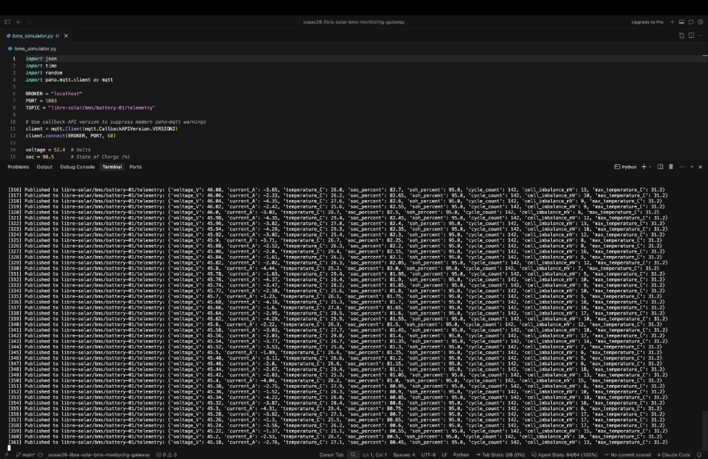

# Open Remote Monitoring Gateway for Libre Solar BMS

An open, deployable remote monitoring gateway that reads live data from the Libre Solar BMS, publishes it to a standard MQTT layer, and integrates with platforms such as [MicroPowerManager (MPM)](https://github.com/EnAccess/micropowermanager) and Home Assistant.

## System architecture

```text
Libre Solar BMS / Simulator  →  MQTT Broker (Mosquitto)  →  MPM Dashboard / Home Assistant
```

## Quickstart (local development)

### Prerequisites

- Docker and Docker Compose
- Python 3.8+
- `paho-mqtt` (`pip install paho-mqtt`)

### 1. Start the local MQTT broker

Run Eclipse Mosquitto:

```bash
docker run -d --name mqtt-broker -p 1883:1883 -p 9001:9001 eclipse-mosquitto
```

### 2. Run the BMS simulator

`bms_simulator.py` publishes simulated telemetry (voltage, current, temperature, SoC, SoH, cell imbalance, and related fields) to the local broker:

```bash
python3 bms_simulator.py
```

Leave this process running. Press `Ctrl+C` to stop. You should see telemetry publishing to `libre-solar/bms/bms-node-01/telemetry`:



### 3. Launch MicroPowerManager (MPM)

Clone and start the MPM backend:

```bash
git clone https://github.com/EnAccess/micropowermanager.git
cd micropowermanager
docker compose up -d
```

### 4. Open the dashboard

1. Open the MPM web dashboard at [http://localhost:8001](http://localhost:8001).
2. Register the device serial `bms-node-01` under Solar Home Systems.

## MQTT topic and payload

**Topic pattern:** `libre-solar/bms/{device_id}/telemetry`

The local simulator uses `device_id` `bms-node-01`, so it publishes to:

```text
libre-solar/bms/bms-node-01/telemetry
```

**Example payload:**

```json
{
  "device_id": "bms-node-01",
  "sequence": 42,
  "timestamp": 1776333000,
  "telemetry": {
    "voltage_V": 51.8,
    "current_A": -2.4,
    "temperature_C": 26.5,
    "soc_percent": 88.4,
    "soh_percent": 95.0,
    "cycle_count": 142,
    "cell_imbalance_mV": 12,
    "max_temperature_C": 29.1
  },
  "quality": "Measured",
  "fault_flags": [],
  "signature": "simulated_ed25519_secure_hash_v1"
}
```

## Contributing

See [CONTRIBUTING.md](./CONTRIBUTING.md) and the [Code of Conduct](./CODE_OF_CONDUCT.md).
